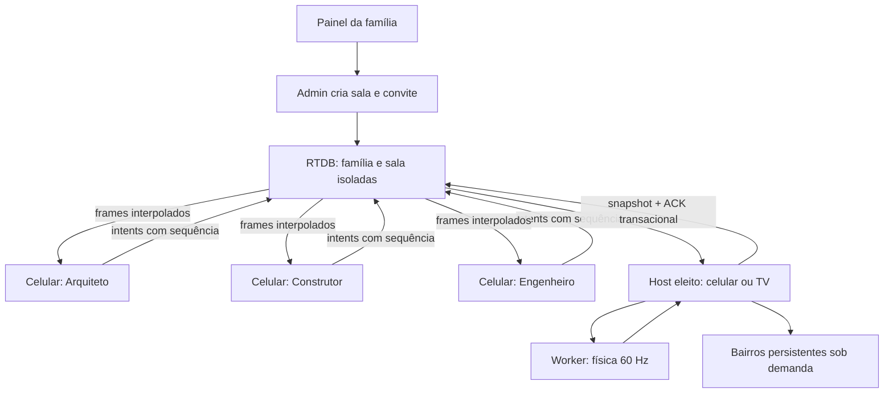

# Torre / Cidade Juntos

Uma torre, uma cidade e a mesma equipe. Jogo estático em ES Modules para 1–6 pessoas, com celular remoto como experiência principal e TV opcional.

**Versão inicial para famílias, publicada mediante autorização do responsável.** O código fica em `nataleujogo/jogos/torrecidade/`: o repositório `torrecidade` não existia na conta acessível. A branch é `cursor/jogo-torrecidade`, baseada em `cursor/plataforma-multifamilia-c89d`. Nenhum jogo legado foi alterado; só o portal, seu card no painel e a adição isolada de regras.

## Jogar

- Abra `index.html` para experimentar a maquete. **Experimentar agora** é uma demonstração local, explicitamente identificada; não conecta celulares em lugares diferentes.
- Abra **Criar sala no painel da família** e entre/crie sua conta em `conta.html`. A conta usa o mesmo app Auth padrão da plataforma. Escolha Torre, Missão Cidade ou Nossa Cidade e o ritmo. Só a conta da família cria configurações e salas.
- Compartilhe o link pelo WhatsApp ou o QR da TV. O link inclui a família, a sala e um convite aleatório de 192 bits. O código curto sozinho não permite ler a sala.
- Cada convidado escolhe nome/avatar; Firebase Auth anônimo funciona de forma invisível. O login do convidado usa o app Firebase `convidado`, separado da sessão do administrador.
- Arquiteto escolhe/gira, Construtor posiciona/solta, Engenheiro escora/segura e Intendente repõe recursos. Sozinho, use as abas para todos os papéis. Pessoas adicionais orientam com marcadores.
- A Missão Cidade pede árvore em `(0,0)`, praça em `(-2,-2)`, rua em `(0,2)` e casa em `(2,2)`. O arquiteto escolhe o tipo; o construtor precisa respeitar a zona.
- Nossa Cidade não tem derrota. A cada 12 peças coletivas abre um bairro; a equipe visita um bairro por vez. O progresso, contribuições e últimas 40 lembranças permanecem salvos.
- Arraste a cena para orbitar, use pinça para zoom, toque no chão para posicionar, ou use as setas 2D. O botão principal fica fixo no celular. O áudio é sintetizado depois de um toque, sem arquivos ou uploads.

## Rodar e testar

Requisitos: Node 22+, Java 17+ para Firebase CLI 14.20.0, Python 3. Não são necessários para servir o site já versionado.

```sh
cd jogos/torrecidade
npm ci
npx playwright install chromium
npm test
npx firebase emulators:exec --only auth,database --project demo-jogos-familia "npm run test:rules"
npx firebase emulators:exec --only auth,database --project demo-jogos-familia "npm run test:e2e"
node scripts/budget.mjs
```

Playwright inicia o servidor HTTP local da raiz do portal. Para explorar manualmente, inicie o Emulator e `python3 -m http.server 8765` na raiz do portal. Abra `http://127.0.0.1:8765/jogos/torrecidade/`.

As regras são testadas por requisições REST autenticadas contra **Auth + RTDB Emulator reais**, incluindo recusas de acesso; não são mocks das regras. A concorrência de transações é exercitada pelas sessões Firebase modular dos navegadores. A demo não é usada para provar multiplayer.

`npm run vendor` apenas reconstrói arquivos versionados a partir das dependências fixadas. Não há build em produção nem CDN em runtime. `scripts/rules.mjs` gera a seção isolada e compõe a regra da raiz preservando `families/`.

## Arquitetura



- `regras.js`: regras puras, distribuição, fila, zonas, recursos, idempotência, estrelas, interpolação e serialização.
- `backend.js`: transporte Firebase modular 10.14.1 e demo local. A única configuração Firebase continua em `../../js/firebase-config.js`; nenhum projeto antigo foi reutilizado.
- `rede.js`: eleição via transação, epoch, lease, presença por conexão (duas TVs com mesmo UID não são confundidas), snapshots duráveis e migração.
- `fisica.worker.js` / `fisica.js`: Cannon ES 0.20.0, passo fixo e acumulador com limite de recuperação; carregado somente pelo host. Rapier foi considerado; Cannon foi escolhido para colisões de blocos, menor payload e ausência do custo inicial WASM. O teste determinístico verifica duas execuções na mesma versão/runtime, não determinismo binário entre arquiteturas.
- `cena.js`: Three 0.160.1, geometria procedural chanfrada, materiais compartilhados, instancing, sombras, AO radial pré-calculado, céu e cena de brinquedo. Esta versão permite WebGL1; versões ≥ r163 removem esse suporte.
- `qualidade.js`: ajuste a cada 2 s por FPS; DPR limitado, sombra 512/1024, opções manuais, pausa do render oculto. Instâncias usam buffers fixos para impedir recriações por peça.

## Persistência e escalabilidade

O snapshot autoritativo inclui estado, ACK por UID e contribuições na **mesma transação**. A interface só confirma uma ação após seu ACK durável. Fechar a última aba abruptamente não depende de conseguir executar código em `pagehide`: a peça já confirmada está no banco. `pagehide`/`visibilitychange` são apenas otimizações; `onDisconnect` remove a presença da conexão. Não é possível prometer que `onDisconnect` execute JavaScript para gerar um snapshot novo.

Cada bairro tem até 25 células, congeladas na física; até 64 bairros são desbloqueados (1.600 peças). Só o bairro compartilhado ativo vai no snapshot e na cena. Ao viajar, o snapshot contém também a obrigação de arquivar o bairro anterior, de modo que um novo host possa concluir a gravação. Os chunks inativos são lidos pontualmente, sem escutar o mundo inteiro. A câmera e a base visual permanecem locais ao bairro. Metadados de contagem permitem expansão sem carregar toda a geometria.

A fase Torre limita 150 corpos; os blocos da cidade são estáticos. O input usa uma caixa por UID, limitada a 200 bytes aproximados por campos, sequência monotônica, limite de frequência no cliente e nas regras. Há uma ação não confirmada por vez, evitando perder ações irreversíveis durante substituição da caixa. Isso favorece confiabilidade; o arraste contínuo a 15 Hz ainda exige canal separado de ghost volátil.

Frames a 10 Hz contêm corpos ativos em posição quantizada e quaternion smallest-three. Snapshot completo a cada 2 s; interpolação usa atraso de 120 ms e extrapola até 250 ms. Não há WebRTC nesta versão: para 6 jogadores o RTDB evita outra malha de conexões, renegociação e diferenças de NAT. `FirebaseBackend` é o ponto de extensão para DataChannel, mantendo RTDB como fallback obrigatório.

Escala entre famílias: nenhum listener em `familias/`, nenhum servidor próprio, dados e conexões por sala. A capacidade total depende das cotas e custos do plano RTDB; não é ilimitada. Medir simultaneidade, conexões e GB transferidos antes de um lançamento amplo. As medições em `docs/performance/` distinguem payload de aplicação de tráfego real de rede: bytes JSON não incluem WebSocket/TLS, keepalive ou retransmissões.

## Segurança e operação manual

1. Produção: projeto dedicado `torre-cidade-juntos`, plano Spark sem cobrança habilitada. Configuração web centralizada em `js/firebase-config.js`; localhost continua isolado no Emulator demo.
2. Auth e-mail/senha para administradores e anônimo para convidados. Não use credenciais de Google/Firebase Console no jogo: a conta da família é criada no próprio jogo.
3. Restringir a chave web no Google Cloud aos HTTP referrers `https://bavkiq-hugby8-cittet.github.io/*`, `http://localhost/*` e `http://127.0.0.1/*`. Nenhuma chave YouTube é usada. Conferir o registro de publicação em `docs/PRODUCAO.md`.
4. O projeto dedicado usa `jogos/torrecidade/database.rules.json`. A regra composta da raiz multifamília é para futura integração da plataforma completa; não sobrescrever bancos de outros jogos.
5. GitHub Pages publica `main`. O portal atual é preservado, com adição de um card e dos arquivos isolados do jogo. URL: `https://bavkiq-hugby8-cittet.github.io/nataleujogo/jogos/torrecidade/`.
6. O reset só aceita a sala `ensaio`; nunca apaga `mundo/`. Para encerrar uma sala real, admin deve marcar `config.closed` e revogar/rotacionar seu convite em um fluxo administrativo revisado.

Regras bloqueiam leitura sem associação, listagens de famílias/salas, UID alheio, alteração de configuração por convidado, estado por não-host, epoch antigo, campos inesperados e excesso de ping. O convite é uma capacidade: quem o recebe pode entrar; não compartilhar publicamente. Os convidados autorizados que assumem host são confiáveis. Sem servidor autoritativo independente, não há proteção completa contra um host malicioso; adequado a cooperação privada, não premiação competitiva.

Não há Storage, foto, microfone, chat livre ou upload. Os textos dos jogadores usam `textContent`. Evitar dados pessoais no nome da sala. Nomes e contribuições ficam no RTDB da família.

## Evidência e limites

Consulte `docs/VALIDACAO.md` para os resultados efetivamente executados, pendências e riscos. Screenshots e vídeos são de Emulator/demo. Uma captura com viewport de iPhone em Chromium **não equivale a executar Safari/iOS real**. Throttling de CPU **não equivale a uma GPU Mali/Adreno**. Testes visuais geram a primeira referência e a revalidam; aprovação humana da arte continua necessária.

Voz e push estão fora do escopo. Pontos de extensão: eventos de presença/contribuição para push opt-in com consentimento; interface separada de comunicação para voz, sem acoplar áudio ao protocolo da física. Não pedir permissão de microfone preventivamente.
